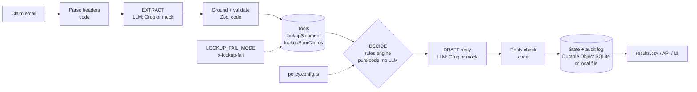

# RouteMax Claims Desk Agent

Reads damage and shortage claim emails, decides each claim against the SOP with a deterministic
rules engine, and drafts the customer reply for a human to review. It never sends email and
never pays anyone.

- **Live URL:** __LIVE_URL__
- **Repo:** __REPO_URL__
- **Today's batch:** `npm run claims` -> [results.csv](results.csv) (16 rows from 15 emails)

## How it works



Three strict layers, and the boundary between them is the safety design:

| Layer | What | Can it change the outcome? |
|---|---|---|
| **Extract** ([src/llm](src/llm)) | LLM turns the email into JSON: is it a claim, shipment id as written, damage or shortage, amount claimed. Zod-validated, one retry. | No. Its output is checked against the email text ([src/grounding.ts](src/grounding.ts)): an amount or shipment id that is not literally in the email is thrown away. |
| **Decide** ([src/engine](src/engine)) | Pure function. Numbered rules R0-R9. Facts come from `shipments.csv`, the POD and the email headers, never from the customer's wording. | Yes. This is the only place a decision or amount is made. Same input, same output. |
| **Draft** ([src/llm](src/llm)) | LLM words the reply in the customer's language from the decision and reason. | No. A deterministic reply check rejects any draft that omits the decision, mentions a different amount, or promises payment; it then falls back to a template. |

After the engine, [src/pipeline.ts](src/pipeline.ts) re-checks the money invariants independently
(approve needs a successful lookup; amount never above min(claimed, declared); never negative).
A violation becomes an escalation with amount 0.

### Decision rules

Order: R0, R2, R1, R3, R5/R6, R4, R7, R8, R9. The `reason` column cites the rule ids.

| Rule | What it does |
|---|---|
| R0 | Not a claim (invoice or POD copy request) -> `not_a_claim` |
| R2 | Shipment lookup. Ids are normalised (case, spacing, letter O vs zero). Unknown -> `need_info`. Sender does not match the shipment's customer -> `need_info`. Lookup tool error -> `escalate`, never approve |
| R1 | Shipment already has a decided or paid claim (October sheet or state) -> `duplicate`, citing the earlier claim and payment reference |
| R3 | Days = email Date header minus delivered date. Late if days > 7 (15 for key accounts). The system clock is never used |
| R5 | Damage + POD "received in good condition" with no damage remarks -> `reject` |
| R6 | Shortage: approve if the POD shows fewer pieces than shipped, reject if it confirms the full count |
| R4 | Damage needs photos: only image files in the **Attachments header** count. "Photos attached" in the body does not. Missing -> `need_info` |
| R7 | Payable = min(claimed, declared value). Missing amount -> `need_info` |
| R8 | Payable > Rs 50,000 -> `escalate` with the recommended capped amount. (R8b: consequential loss mentioned -> `escalate`) |
| R9 | Otherwise `approve` |
| E1-E3 | Pipeline guards: extraction failed, ungrounded LLM output, safety invariant violated -> never an approval |

## Run it

Requires Node 20.12+ (built on Node 24).

```bash
npm install
npm run claims          # process data/claim_emails -> results.csv  (mock mode: no key, no network)
npm run claims:groq     # same, with the live LLM (needs GROQ_API_KEY in .env)
npm test                # unit tests (Vitest)
npm run eval            # eval suites, writes eval_runs/
npm run dev             # local Worker + UI at http://127.0.0.1:8787
```

`npm run claims` flags: `--mode mock|groq`, `--in <dir>`, `--out <file>`, `--policy '<json>'`,
`--fail-mode none|error|timeout|not_found`, `--resume` (keep state from earlier runs; by default
each batch run starts clean so it is reproducible).

Secrets live in `.env` (gitignored). Copy `.env.example`. The Groq key is read from
`GROQ_API_KEY` only.

### LLM

`LLM_MODE=mock` (default) is a deterministic heuristic extractor plus template replies, so the
whole pipeline and every eval run offline. `LLM_MODE=groq` calls Groq's OpenAI-compatible API
at temperature 0 with JSON-schema structured output. The model name is `groqModel` in
[src/config.ts](src/config.ts) (override with `GROQ_MODEL`), currently `openai/gpt-oss-120b`.
Groq's structured-outputs and models pages, as read during the build on 2026-11-19, list two
Production models that support strict `json_schema` output: `openai/gpt-oss-120b` and
`openai/gpt-oss-20b`. The larger one was chosen for Hinglish and multi-claim emails. If Groq
answers 400 to a `json_schema` request the client falls back to `json_object` for that call.

> **Live mode is not yet verified.** The `GROQ_API_KEY` supplied during the build was rejected
> by Groq (HTTP 401, invalid API key), so no live call has succeeded. The Groq client is covered
> by 20 tests against a fake server. Until a valid key is set, the deployed Worker runs in mock
> mode and says so in `/health`. With a valid key in `.env`: `npm run eval -- --mode groq`.

Local `wrangler dev` reads `.env` when there is no `.dev.vars`, and `wrangler.jsonc` asks for
`LLM_MODE=groq`. Copy `.dev.vars.example` to `.dev.vars` for offline local development.

### API (same Worker serves the UI at `/`)

| Method | Path | |
|---|---|---|
| POST | `/claims` | One email. JSON `{ "email": "...", "claim_id": "C01" }` or `text/plain`. Returns rows, rules fired, trace, draft |
| POST | `/claims/batch` | `{ "emails": [{ "email": "...", "claim_id": "..." }] }`, processed in order. In live mode keep batches small (the UI sends 4 at a time): each email costs several subrequests and the Workers free plan caps them per request |
| GET | `/claims` | Everything processed so far |
| GET | `/results.csv` | The review sheet |
| GET | `/audit?limit=50` | Audit log: inputs, rules fired, config snapshot per decision |
| GET | `/health` | Mode, model, policy, fail mode |
| POST | `/admin/reset` | Wipe state (demo mode only) |

```bash
curl -s -X POST "$URL/claims" -H "content-type: application/json" \
  -d "$(node -e "console.log(JSON.stringify({claim_id:'C01',email:require('fs').readFileSync('data/claim_emails/C01.txt','utf8')}))")"
```

## Config switches

All in [src/policy.config.ts](src/policy.config.ts), all switchable without a code change through
`POLICY_OVERRIDES` (JSON; `.env` locally, a Worker var in production) or `--policy` on the CLI.

| Switch | Default | Effect |
|---|---|---|
| `defaultWindowDays` | 7 | Claim window |
| `keyAccountWindows` | `{ "Zenith Retail": 15 }` | Longer window per customer |
| `smallClaimPhotoWaiverInr` | 0 (off) | Damage claims at or under this need no photos |
| `shortageProRata` | false | Cap shortage at missing/shipped x declared value |
| `payConsequentialLoss` | false | If false, claims mentioning downtime or lost sales are escalated |
| `approvalLimitInr` | 50000 | Payable above this needs the Claims Manager |

```bash
npm run claims -- --policy '{"smallClaimPhotoWaiverInr":5000}'   # C04 and C14/SHP-1015 become approvals
npm run claims -- --policy '{"shortageProRata":true}'            # C03 -> 3,600 and C09 -> 6,000
```

The evidence behind each default is in [ASSUMPTIONS.md](ASSUMPTIONS.md) under "Questions for Meera".

## Failure injection

The shipment lookup can be made to fail on demand.

- Environment: `LOOKUP_FAIL_MODE = none | error | timeout | not_found`
- Per request: header `x-lookup-fail` with the same values, honoured only when `ALLOW_FAULT_INJECTION=1`
- CLI: `npm run claims -- --fail-mode error`

| Mode | What the tool does | Decision | Amount | Reason |
|---|---|---|---|---|
| `none` | Normal lookup | per rules | per rules | |
| `error` | Returns a service error | `escalate` | 0 | "R2: shipment lookup failed ... never approved without a successful lookup" |
| `timeout` | Hangs; cut off after `lookupTimeoutMs` (2 s) | `escalate` | 0 | "lookup failed: timeout" |
| `not_found` | Every id is unknown | `need_info` | 0 | "shipment not found" |

`not_found` is `need_info` rather than `escalate` on purpose: the engine cannot tell an injected
not-found from a customer's mistyped id, and asking the customer to confirm the id is the right
next step for both. No fail mode can produce an approval or a non-zero amount; the eval suite
asserts this for each mode.

```bash
curl -s -X POST "$URL/claims" -H "x-lookup-fail: error" -H "content-type: text/plain" \
  --data-binary @data/claim_emails/C10.txt
```

## Evals

```bash
npm run eval                    # mock mode, plus the golden set on Groq when GROQ_API_KEY is set
npm run eval -- --mode mock     # offline only
npm run eval -- --suite A,D
```

Explicit pass/fail per case, non-zero exit code on any failure. Every run, including failing
runs, writes `eval_runs/<timestamp>-<mode>.json` (case id, expected, actual, pass/fail, rules
fired, config, model, git sha) and a `.summary.md`. Runs are never overwritten and are committed.

| Suite | What |
|---|---|
| A | Golden set: today's 15 emails, default config, 16 rows |
| B | Config variants: photo waiver at 5000, shortage pro-rata |
| C | Regression: all 26 October decisions replayed through the engine. Disagreements with the humans are listed as known deviations with the reason, not hidden |
| D | Risk cases for an agent that can approve money: prompt injection, cap and limit boundaries, day 7/8 and 15/16, unknown and wrong-customer ids, every lookup fail mode, idempotency, duplicates, fake photo claims, PDF-only, multi-claim emails, non-claims, abusive and urgent tone, Hinglish, missing amount, reply checks |
| E | Suite A again on the live LLM |

Latest result (newest file in [eval_runs/](eval_runs)): **113 of 113 cases pass in mock mode.**

| Suite | Cases | Passed | Notes |
|---|---|---|---|
| A golden set | 16 | 16 | 15 emails, 16 rows, plus the row-count check |
| B config variants | 32 | 32 | Whole golden set re-run under each variant, so "nothing else changed" is asserted too |
| C October regression | 27 | 27 | Engine agrees with the humans on 20 of 26 (76.9%). 6 known deviations, 0 unexpected |
| D risk cases | 38 | 38 | 29 from the first pass plus 9 added after it |
| E live LLM | not run | - | Groq rejected the supplied key. Reported as not run, not as passed |

The 6 known deviations in Suite C are the team doing something the SOP does not say: 5 small
damage claims approved without photos, and 1 late claim approved because sales asked. They are
listed with reasons in each run's summary. A new disagreement, or a listed one that starts
agreeing, fails the suite, so the list cannot go stale.

Unit tests: `npm test`, 299 tests.

One earlier run failed on a case that would have paid Rs 18,000 to a spoofed sender. That
failure, the fix and the new test are in [FIX_LOG.md](FIX_LOG.md). Both runs are kept.

## Deploy

```bash
npx wrangler deploy
npx wrangler secret put GROQ_API_KEY
node scripts/smoke.mjs https://routemax-claims-desk.<subdomain>.workers.dev
```

Or, with tokens in `.env` (`CLOUDFLARE_API_TOKEN`, `CLOUDFLARE_ACCOUNT_ID`, `GROQ_API_KEY`,
`GITHUB_TOKEN`): `npm run ship` creates the private repo, pushes, deploys, sets the secret and
runs the smoke test. Without a Groq secret the Worker runs in mock mode and says so in `/health`.

The deployed Worker runs in demo mode (`ALLOW_FAULT_INJECTION=1`, no auth) so the failure
injection can be shown live. Before real use: set it to `0` and put the Worker behind Cloudflare
Access.

## Safety properties, and where each is enforced

| Property | Enforced in |
|---|---|
| LLM never chooses decision or amount | Engine is pure code; pipeline grounding; reply check |
| Email content is untrusted; instructions and urgency are ignored | Headers parsed by code; body only reaches the LLM as delimited data; decisions use data facts only |
| Never approve without a successful lookup | Engine R2 + pipeline invariant E3 |
| Amount never above min(claimed, declared), never negative | Engine R7 + pipeline invariant E3 |
| Drafts only | No send or payment code exists |
| Idempotent | sha256 of the normalised email; insert-if-absent in the store |
| Audit log | Every decision: inputs, rules fired, config snapshot, model |
| No credentials in the repo | `.env`, `.dev.vars` gitignored; examples committed |

## Layout

```
src/types.ts            contracts (Zod schemas + interfaces)
src/policy.config.ts    policy switches
src/email.ts            header parsing, idempotency hash
src/grounding.ts        checks LLM output against the email text
src/pipeline.ts         extract -> decide -> draft -> store
src/engine/             rules engine (pure)
src/llm/                Groq client, extractor, drafter, mock mode, reply check
src/tools/              data loaders, lookup tools, failure injection
src/store/              memory and file stores
src/worker/             Hono routes, Durable Object store
src/cli/claims.ts       npm run claims
public/index.html       review UI
evals/                  eval harness and risk cases
eval_runs/              every eval run, committed
data/                   the inputs as received
```

More: [ASSUMPTIONS.md](ASSUMPTIONS.md) | [FIX_LOG.md](FIX_LOG.md) | [WALKTHROUGH.md](WALKTHROUGH.md) | [BRIEF.md](BRIEF.md)
